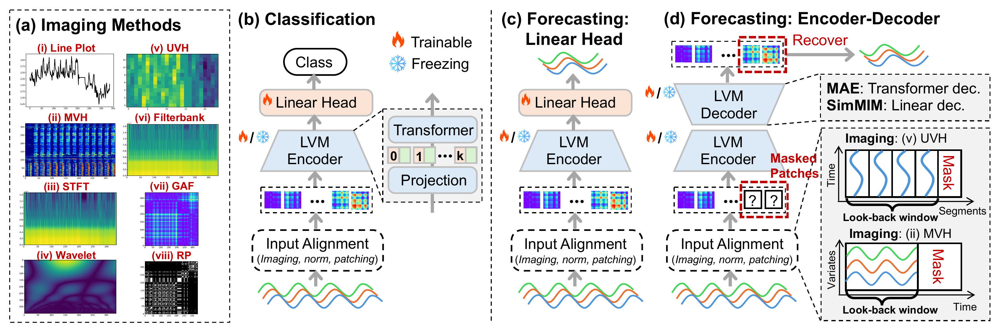
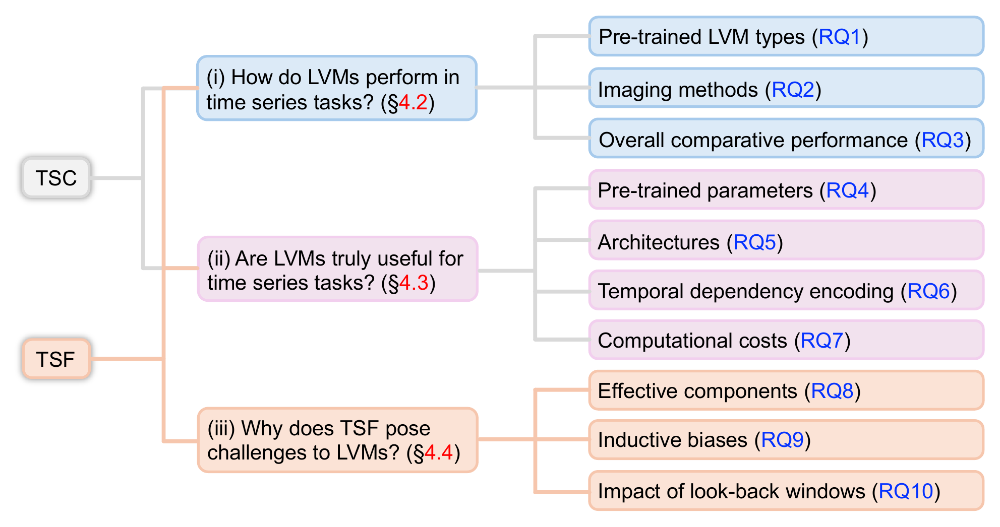
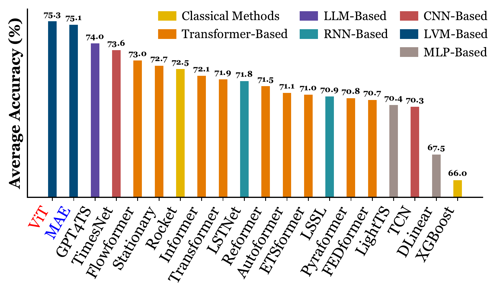
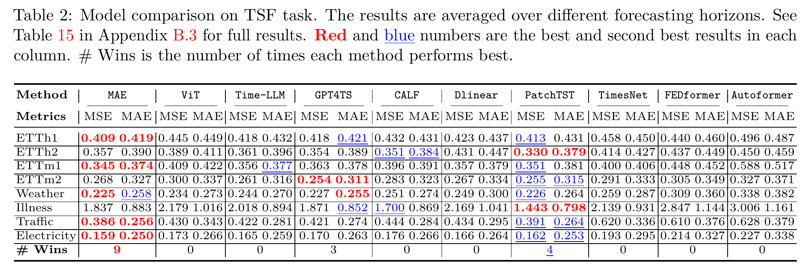
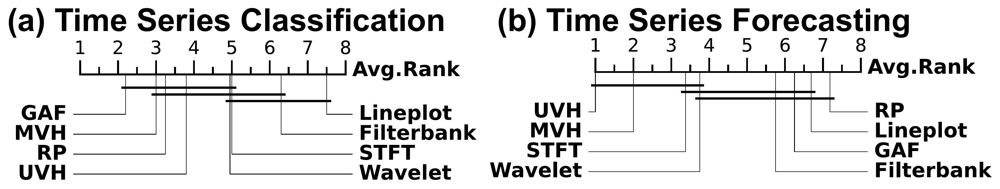
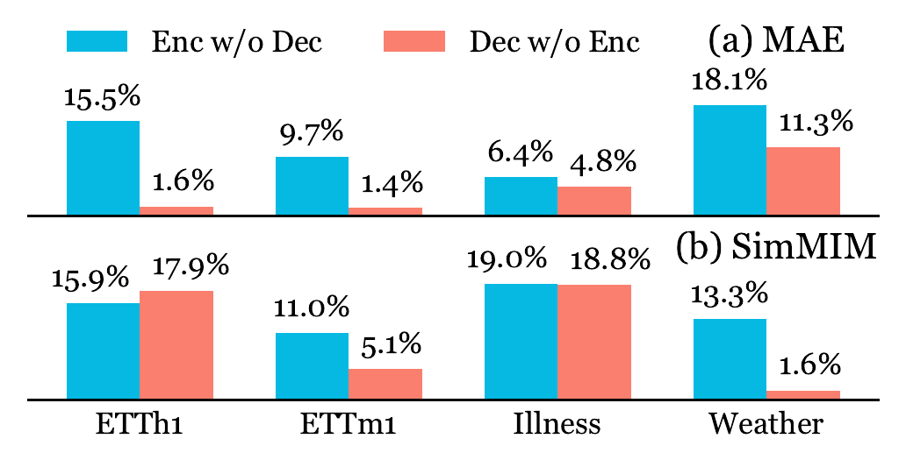
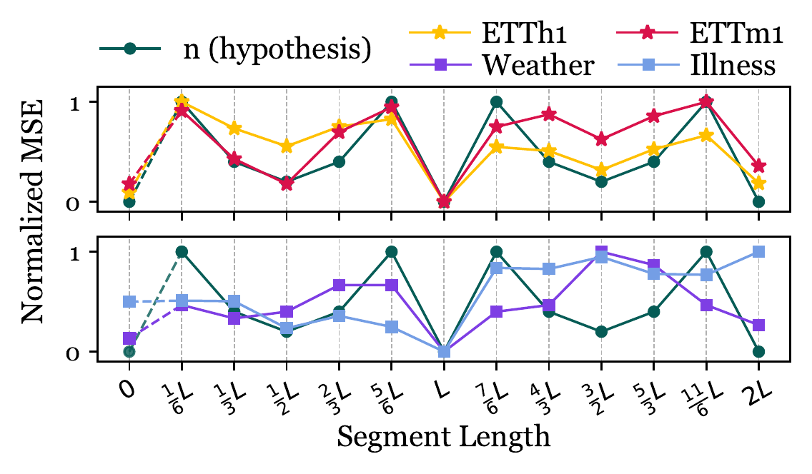
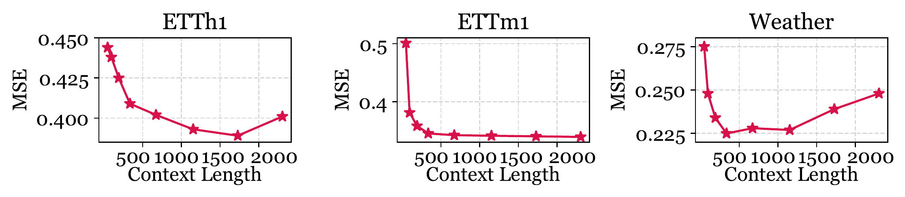

<div align="center">

# (TMLR 2026) From Images to Signals: Are Image-Pretrained Vision Models Useful for Time Series Analysis?

[](https://openreview.net/forum?id=aWVG2rN4OV)
[](https://openreview.net/forum?id=aWVG2rN4OV)

[](LICENSE)


**[ChengAo Shen](https://github.com/ChengAoShen)<sup>1</sup>, Hanghang Tong<sup>2</sup>, Dongjin Song<sup>3</sup>, Zhigang Deng<sup>1</sup>, Qingsong Wen<sup>4</sup>, Jingchao Ni<sup>1</sup>**

<sup>1</sup>University of Houston &nbsp; <sup>2</sup>University of Illinois Urbana-Champaign &nbsp; <sup>3</sup>University of Connecticut &nbsp; <sup>4</sup>Squirrel Ai Learning

🔍 [About](#about) · 🧩 [Framework](#framework) · 🚀 [Quick Start](#quick-start) · 📊 [Findings](#findings) · 🔗 [Citation](#citation)

</div>

<a id="about"></a>
## 🔍 About

This is the official repository for the TMLR 2026 paper "[From Images to Signals: Are Image-Pretrained Vision Models Useful for Time Series Analysis?](https://openreview.net/forum?id=aWVG2rN4OV)".

Image-pretrained large vision models (LVMs) are increasingly used for time series: a series is first *imaged*, then fed into a vision backbone. This work is a benchmark study that asks not only **whether** LVMs work for time series, but also **why** they succeed or fall short, on both a high-level task (classification) and a low-level task (forecasting).

> In this work, "LVM" refers to image-pretrained models with standalone vision backbones. Vision-language and multimodal foundation models are out of scope.

### 🔑 Key Features

- **Large-scale benchmark:** 4 LVMs (ViT, Swin, MAE, SimMIM), 8 imaging methods, 18 datasets, and 21 baselines, with additional backbones (DINOv2, MLCD, LaVin-DiT, and the Qwen-VL vision encoder) in the appendix.
- **Ten research questions:** covering pretraining type, imaging method, fine-tuning strategy, architecture, temporal dependency, computational cost, model components, inductive bias, and look-back windows.
- **Practical guidance:** which LVM, imaging method, and fine-tuning strategy to use for each task, and where current LVM forecasters fall short.

<a id="framework"></a>
## 🧩 Framework

<div align="center">

| [](docs/assets/framework.png) |
|:--:|
| **Figure 1.** (a) The eight imaging methods. (b) LVM-based classification with a linear head. (c) LVM-based forecasting with a linear head. (d) LVM encoder-decoder forecasting, which masks the future patches and reconstructs them with the pretrained decoder. |

</div>

The study is organized around ten research questions (RQs) in three groups:

<div align="center">

| [](docs/assets/research_questions.png) |
|:--:|
| **Figure 2.** Structure of the experiments. |

</div>

<a id="quick-start"></a>
## 🚀 Quick Start

<!-- TODO: fill in once the code is uploaded (environment, data, and run commands). -->

### 1. Environment

```bash
git clone https://github.com/D2I-Group/img2signal.git
cd img2signal
pip install -r requirements.txt
```

### 2. Data

- **Classification:** the 10 UEA multivariate datasets used in the paper.
- **Forecasting:** ETTh1, ETTh2, ETTm1, ETTm2, Weather, Illness, Traffic, and Electricity.

### 3. Run

```bash
# Coming soon
```

<a id="findings"></a>
## 📊 Findings

### RQ1–RQ3: How do LVMs perform?

**Classification.** With GAF imaging, both the supervised ViT and the self-supervised MAE achieve the best average accuracy on 10 UEA datasets, ahead of all 19 non-LVM baselines.

<div align="center">

| [](docs/assets/classification.png) |
|:--:|
| **Figure 5.** Average accuracy (%) on 10 UEA datasets. |

</div>

**Forecasting.** Only the self-supervised MAE with UVH imaging is competitive. It wins 9 of 16 dataset-metric cases, while the classification-pretrained ViT is roughly on par with DLinear.

<div align="center">

| [](docs/assets/table_forecasting.png) |
|:--:|
| **Table 2.** Forecasting results averaged over four horizons. |

</div>

**Imaging methods.** The best imaging method depends on the task: GAF for classification, and UVH (which keeps raw values in pixels) for forecasting.

<div align="center">

| [](docs/assets/imaging_methods.png) |
|:--:|
| **Figure 4.** Average ranks of the eight imaging methods (lower is better). |

</div>

### RQ4–RQ7: Are LVMs truly useful?

| RQ | Question | Finding |
|:--:|---|---|
| RQ4 | Are pretrained parameters useful? | Yes. A frozen LVM beats training from scratch on every classification dataset. Fine-tuning MLP + norm layers is enough for classification; fine-tuning only norm layers works best for forecasting. |
| RQ5 | Is the architecture overly complex? | No. Pretrained LVMs outperform simpler models built from the same components. |
| RQ6 | Do LVMs use temporal order? | Yes. Shuffling or masking time steps hurts LVMs more than simpler models. |
| RQ7 | What does it cost? | Inference is about 4× faster than the best classification baseline, but about 20× slower than the best forecasting baseline. |

### RQ8–RQ10: Why is forecasting hard for LVMs?

**Pretrained decoders matter more than encoders.** Re-initializing the decoder hurts more than re-initializing the encoder, even for SimMIM, whose decoder is a single linear layer. This also explains why supervised LVMs, which lack a pixel decoder, struggle with forecasting.

<div align="center">

| [](docs/assets/encoder_decoder.png) |
|:--:|
| **Figure 8.** Forecasting performance drop (%) when only the encoder (blue) or only the decoder (red) keeps its pretrained parameters. |

</div>

**A bias toward periodicity.** MAE with UVH forecasts by "combining past periods". Its error follows the number of segments $n = k/\gcd(i, k)$ before a segment reoccurs (Lemma 4.1), closely on strongly periodic data and less so on weakly periodic data.

<div align="center">

| [](docs/assets/periodicity_bias.png) |
|:--:|
| **Figure 10.** Normalized MSE of MAE vs. UVH segment length; the green curve is $n$. |

</div>

**Limited use of long look-back windows.** Error decreases up to roughly 500–1500 steps and then plateaus or rises, as fixed-size images limit how much of a long series can be encoded.

<div align="center">

| [](docs/assets/lookback.png) |
|:--:|
| **Figure 11.** MSE of MAE (UVH) with varying look-back window lengths. |

</div>

### ✅ Recommended Configurations

| | Classification | Forecasting |
|---|---|---|
| **Model** | ViT or MAE | MAE (self-supervised) with its pretrained decoder |
| **Imaging** | GAF | UVH |
| **Fine-tuning** | MLP and norm layers | Norm layers only |
| **Best suited to** | Pattern-based tasks | Periodic data; look-back up to about 1500 steps |

<a id="citation"></a>
## 🔗 Citation

If you find this work useful, please consider citing:

```bibtex
@article{shen2026images,
  title   = {From Images to Signals: Are Image-Pretrained Vision Models Useful for Time Series Analysis?},
  author  = {Shen, ChengAo and Tong, Hanghang and Song, Dongjin and Deng, Zhigang and Wen, Qingsong and Ni, Jingchao},
  journal = {Transactions on Machine Learning Research},
  issn    = {2835-8856},
  year    = {2026},
  url     = {https://openreview.net/forum?id=aWVG2rN4OV}
}
```

## 🙏 Acknowledgments

This work was supported in part by the NVIDIA Academic Grant Program. We thank Dr. Eamonn Keogh for his insightful comments on the experimental design.

## 📚 Related Work from D2I Group

- [Awesome Vision for Time Series](https://github.com/D2I-Group/awesome-vision-time-series): Harnessing Vision Models for Time Series Analysis: A Survey (IJCAI 2025)
- [DMMV](https://github.com/D2I-Group/dmmv): Multi-Modal View Enhanced Large Vision Models for Long-Term Time Series Forecasting (NeurIPS 2025)
